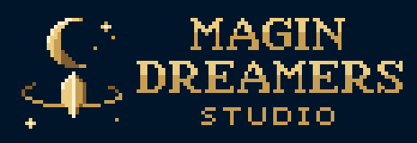

  

<h1 align="center">Magin Dreamers: marca</h1>

Identidade visual da Magin Dreamers em pixel art no padrão 32 bits.

## O que tem aqui

| Pasta | Conteúdo |
| --- | --- |
| `animacao/` | Estrelas piscando, brilho descendo no cristal e luz correndo na órbita, em laço de 32 quadros (90 ms cada): GIF e folha de quadros do avatar, do símbolo e da logo vertical. |
| `logo/` | Logo completa nas versões vertical e horizontal, com fundo e transparente. |
| `avatar/` | Símbolo com margem pro recorte redondo: foto da org, WhatsApp, Discord, itch, Trello. `8x` = 640 px, `16x` = 1280 px. |
| `simbolo/` | Só o símbolo (lua, cristal e órbita), pra avatar e ícone. |

Cada arte vem no tamanho original (`1x`) e ampliada sem perder o pixel (`2x`, `4x`, `8x`...).

## Cores

Rampa de 6 tons de dourado sobre azul-noite, em cor de 15 bits.

| Cor | Hex |
| --- | --- |
| Azul-noite (fundo) | `#001028` |
| Dourado 1 (sombra) | `#482820` |
| Dourado 2 | `#784828` |
| Dourado 3 | `#A87038` |
| Dourado 4 | `#D0A050` |
| Dourado 5 | `#E8C878` |
| Dourado 6 (brilho) | `#F8E8C0` |

## Uso

A marca Magin Dreamers e estas artes são de uso exclusivo do estúdio. Todos os direitos reservados.
