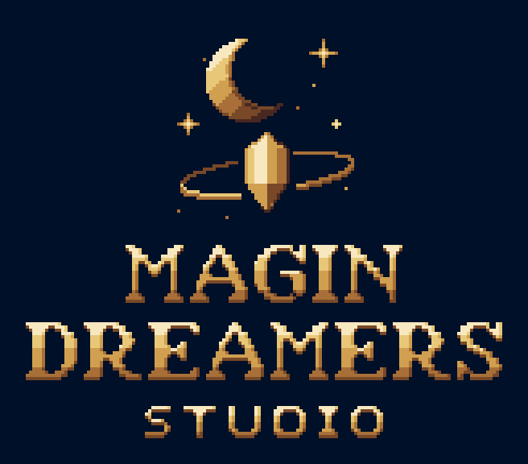

  

<h1 align="center">Magin Dreamers: marca</h1>

Identidade visual da Magin Dreamers em pixel art.

## O que tem aqui

| Pasta | Conteúdo |
| --- | --- |
| `logo/` | Logo completa nas versões vertical e horizontal, com fundo e transparente. |
| `avatar/` | Símbolo com margem pro recorte redondo: foto da org, WhatsApp, Discord, itch, Trello. `16x` = 640 px, `32x` = 1280 px. |
| `simbolo/` | Só o símbolo (lua, cristal e órbita), pra avatar e ícone. |

Cada arte vem no tamanho original (`1x`) e ampliada sem perder o pixel (`4x`, `8x`, `16x`...).

## Cores

| Cor | Hex | Uso |
| --- | --- | --- |
| Azul-noite | `#00152A` | fundo |
| Dourado escuro | `#805C2E` | sombra, órbita de trás |
| Dourado | `#C69E54` | cor principal |
| Dourado claro | `#EACC82` | luz |
| Brilho | `#FCF0C8` | ponto mais claro, estrelas |

## Uso

A marca Magin Dreamers e estas artes são de uso exclusivo do estúdio. Todos os direitos reservados.
